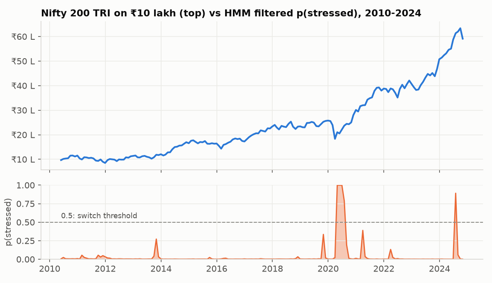

# Factor Regime Rotation: does HMM regime timing beat a static factor mix?

Does a monthly allocation across NSE's Momentum, Quality, Value and Low Volatility indices that follows the market regime beat simply holding all four? Using NSE Total Returns Index data from 2005 to 2026, regimes from a hidden Markov model and a trend-volatility rule, and a walk-forward test: **no. A static equal-weight factor mix beat every timing model after costs.** No timing or tilt rule beat equal weight with a t-statistic above 2 in any period, and on the 24-month holdout, scored once, all five rules trailed it. The equal-weight mix did beat the Nifty 200 in development, 16.5% against 13.0% CAGR (t = 2.51).

*Hypothetical backtest on index data, mostly NSE back-calculation before 2020. Not investment advice.*

| After costs (benchmarks: no costs) | Development 2010-05 to 2024-10: CAGR / Sharpe | Live 2020-09 to 2024-10: CAGR / Sharpe | Holdout 2024-11 to 2026-10: total return / Sharpe | Holdout vs equal weight, per month (t) |
|---|---:|---:|---:|---:|
| Equal-weight factor mix | 16.5% / 0.64 | 29.8% / 1.45 | −5.0% / −0.47 | |
| Best timing model in development: HMM regime rule | 17.8% / 0.77 | 26.0% / 1.25 | −14.1% / −0.71 | −0.40% (−1.86) |
| NIFTY 200 TRI (index) | 13.0% / 0.44 | 23.6% / 1.13 | −1.2% / −0.37 | +0.15% (0.61) |

The best timing rule in development led equal weight by only +0.08% a month (t = 0.66), and its edge came from a near-constant momentum + quality tilt held in 166 of 174 months. Trial 5 tested that tilt as a static rule, and it also trailed on the holdout (−0.34% a month, t = −1.55). All five rules and both benchmarks are in [results/research_note.md](results/research_note.md); the numbers are in [results/backtest_summary.csv](results/backtest_summary.csv) and [results/holdout_result.csv](results/holdout_result.csv).



## Method

The HMM is a two-state Gaussian model on the NIFTY 50's monthly log return and realised volatility, refitted at every month-end on data up to that month (expanding window, best of five seeds). The decision at month-end t uses only the filtered probability of the stressed state at t, the last row of `predict_proba` on data ending at t, never a smoothed probability; a check confirms it against a hand-coded forward pass. Five rules were tested: factor momentum (top two by 12-month return), a rule-based regime ranking (trend × volatility), an HMM regime ranking, an HMM defensive switch (quality and low volatility when p(stressed) > 0.5), and a static momentum + quality tilt chosen after seeing development data. Costs are the expense ratio of a real ETF for each factor (0.25–0.76% a year) plus 0.20% per unit of one-way turnover.

## Validation

Weights are decided at month-end t and held over t+1, and a check confirms that deleting all later data changes no regime, probability or weight. The five trials were registered in [results/trials.csv](results/trials.csv) and [results/preregistration.md](results/preregistration.md) before the holdout was loaded. The holdout was scored once ([results/holdout_runs.log](results/holdout_runs.log)), and the holdout command refuses to run again. The index data matches NSE's published 1, 3 and 5-year returns to two decimals ([results/data_check.md](results/data_check.md)).

## Limitations

The HMM was stressed in only 5 of 174 development months (March–June 2020 and June 2024), so it acted as a crisis detector and the regime averages rest on few months. Most of the development period is NSE's back-calculation, published before the indices launched (Low Volatility 2016, Quality 2018, Momentum 2020). The holdout is 24 months with low power, and every strategy lost money in it. The t-statistics are not adjusted for the five trials, costs are approximate, and indices are not investable returns.

## Reproducing

The data is not in the repository; `download` fetches it from niftyindices.com in about 10 minutes.

```bash
pip install -e .
python scripts/run.py download   # data/raw/
python scripts/run.py all        # data check, regimes, HMM fits, walk-forward backtest, all checks
python scripts/run.py note       # results/research_note.md
python scripts/run.py holdout    # already run once; refuses to run again
```

Every setting is in [configs/config.yaml](configs/config.yaml). On the download of 5 Nov 2026, `all` reproduces every committed result file exactly, except the run date in `results/data_check.md`.
