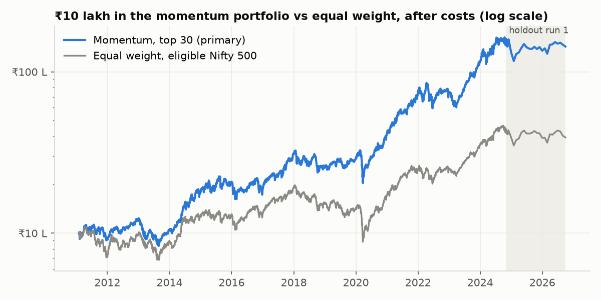

# Momentum on point-in-time Nifty 500 (2011–2026)

Does 12-1 / 6-1 price momentum earn a premium on the Nifty 500 after Indian costs, using the index as it was on each date rather than today's list? On membership rebuilt from NSE notices and prices checked against NSE bhavcopies, the momentum portfolio beat equal weight by **0.93% a month (t = 2.89) in walk-forward out-of-sample months**. Over the development period it returned a CAGR of 21.8% with a Sharpe of 0.72, against 11.2% and 0.31 for equal weight, and the Fama-MacBeth slope survives the usual controls (t = 3.91). It is largely the known Indian momentum factor, and the 23-month holdout is too short to confirm it.

*Hypothetical backtest. Costs are assumptions marked VERIFY. Not investment advice.*

| Period | Strategy | CAGR | Sharpe | Max drawdown | Excess over equal weight, per month (t) |
|---|---|---:|---:|---:|---:|
| Development (2011-01 to 2024-10) | Primary: blend, top 30, monthly | 21.80% | 0.72 | −37.38% | 0.75% (2.91) |
| | Equal weight (eligible universe) | 11.22% | 0.31 | −55.32% | |
| Walk-forward out of sample (2016-02 to 2024-10) | Primary: blend, top 30, monthly | 28.72% | 0.94 | −27.00% | 0.93% (2.89) |
| | Selection re-chosen in each fold | 24.77% | 0.80 | −35.88% | 0.68% (2.04) |
| | Equal weight (eligible universe) | 15.84% | 0.51 | −51.62% | |
| Holdout, run once (2024-11 onward, 23 months) | Frozen selection: blend, top 50, quarterly | 1.67% | −0.10 | −25.37% | 0.62% (1.56) |
| | Primary: blend, top 30, monthly | −3.21% | −0.30 | −26.57% | 0.24% (0.59) |
| | Equal weight (eligible universe) | −5.19% | −0.49 | −19.01% | |

Every number with its source file: [docs/resume_numbers.md](docs/resume_numbers.md). Write-up: [docs/research_note.md](docs/research_note.md).



## Method

The universe at each month-end is the stocks that were Nifty 500 members that day, rebuilt from NSE and niftyindices.com index-change notices (2009–2026) and checked both backwards from today's list and forwards from the earliest one. A stock is eligible with at least ₹5 crore median traded value, 252 days of history and no unadjusted corporate event in the look-back. The signal is z(0.5·z(12-1) + 0.5·z(6-1)). The portfolio holds the top 30 at equal weight, keeps a holding while it ranks within 45, caps any sector at 25%, rebalances monthly and trades at the next session's close. Costs include STT, exchange and SEBI fees, stamp duty, GST, the DP charge and 5/10/20 bps slippage by liquidity.

## Validation

Twenty trials were logged before they ran, against a pre-registration in [configs/preregistration.md](configs/preregistration.md). The walk-forward uses expanding windows with a one-month embargo; the fixed primary's deflated Sharpe at 18 trials is 0.98. The holdout configuration was frozen and committed before its single run ([frozen_config.json](results/phase4/frozen_config.json), [holdout_runs.log](results/phase4/holdout_runs.log)). The signal itself has a rank IC of 0.044 (t = 3.08). Sector- and size-neutral versions, capacity and a spanning test against the IIMA factors are in [results/phase5/](results/phase5/). Using today's constituent list for every date would inflate the universe return by about 5.4% a year.

## Limitations

The holdout has 23 months, and the frozen selection's t-statistic there is 1.56; only about 1.14% a month would reach t = 2, so it neither confirms nor rejects the result. Q5 minus Q1 correlates 0.76 with IIMA's WML factor, and against the IIMA four factors the alpha is 0.67% a year (t = 0.26): this is an implementable version of Indian momentum, not a separate source of return. Costs are assumptions, delisted holdings are sold at their last close, and two index notices are missing.

## Reproducing

Raw data (about 1 GB) is not in the repository. The download steps fetch it from NSE, niftyindices.com, Yahoo Finance, the Internet Archive and IIMA. Files that have to be placed by hand go in `Data/raw/manual/`.

```bash
pip install -e .
python scripts/run.py universe-download && python scripts/run.py industry   # notices, lists, industries
python scripts/run.py prices-download                                        # several hours
python scripts/run.py all      # every result from the raw files, about an hour (the holdout is re-rendered, not rerun)
python scripts/run.py check    # all data and backtest checks
```

Single stages (`phase2-all`, `backtest`, `walkforward`, `institutional`, `writeup`) can be run on their own; `python scripts/run.py --help` lists them. Paths and thresholds are in [configs/config.yaml](configs/config.yaml). Code is in `src/momentum/` (extract, transform, report); tests run with `pytest` and need no data.
