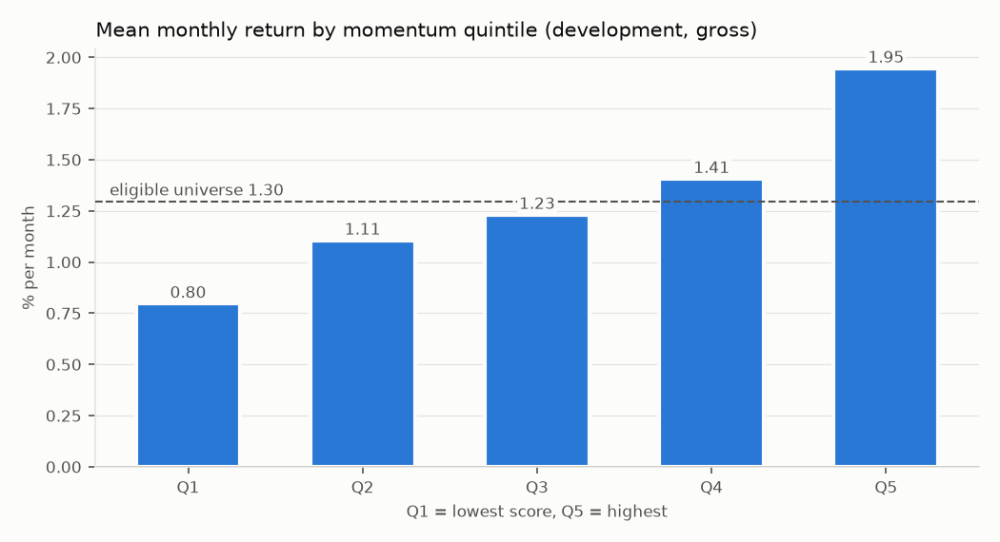
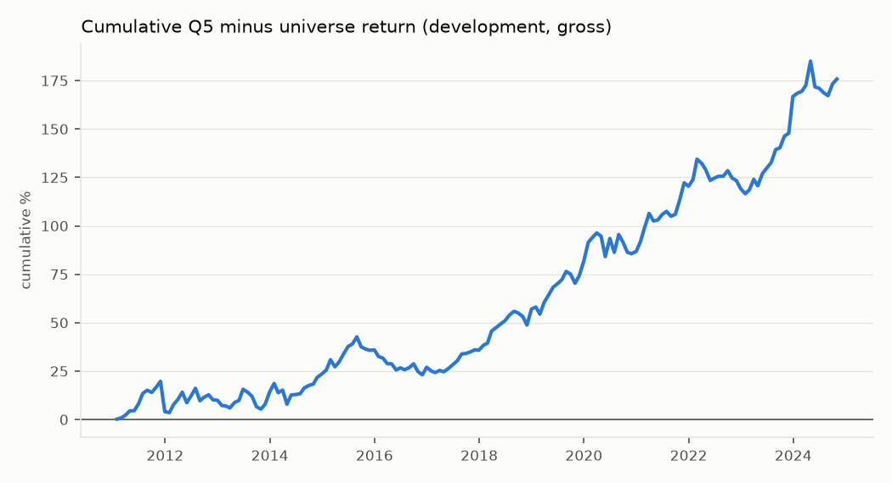
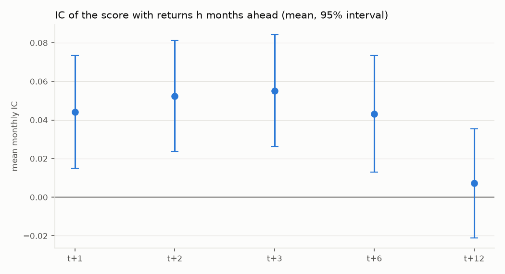
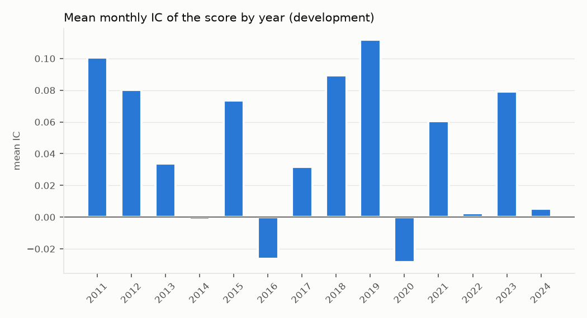

# Signal diagnostics

**Development period only; holdout locked.**

Signal months 2011-01 to 2024-10 (166 months). Returns run from the execution close after each signal date to the execution close after the next one, equal weight, gross of costs. t-statistics are Newey-West with 3 lags.

## Reading

- **IC.** The score's mean monthly rank IC is 0.044 (t = 3.08), positive in 65% of months; ICIR 0.23 (0.80 annualised). Of the two parts, 12-1 is stronger (12-1: 0.052, t = 3.26; 6-1: 0.034, t = 2.63). Years with a negative mean IC: 2014, 2016, 2020.
- **Quintiles.** Mean monthly return rises from 0.80% in Q1 to 1.95% in Q5 (universe 1.30%); monotonicity 1.00. Q5 minus Q1: 1.15% a month (t = 2.55); Q5 minus universe: 0.65% (t = 3.34). Deciles: D10 minus D1 1.48% (t = 2.56), monotonicity 0.93.
- **Decay.** Single-month IC is t+1 0.044 (t = 3.08), t+2 0.052 (t = 3.86), t+3 0.055 (t = 3.89), t+6 0.043 (t = 2.56), t+12 0.007 (t = 0.49). The signal peaks at t+3; half-life about 2.9 months after its peak at t+3.
- **Liquidity.** Q5 minus Q1 within liquidity terciles: tercile 1 (least liquid) 1.25% (t = 2.43); tercile 2 (middle liquid) 1.12% (t = 2.35); tercile 3 (most liquid) 1.00% (t = 1.80). The spread is larger among the least liquid third than the most liquid.
- **Survivorship.** Using today's list for all dates (the old method, NSE-built prices for today's members) gives mean IC 0.043 (t = 3.22) and Q5 minus Q1 1.35% (t = 3.51), against 0.044 (t = 3.08) and 1.15% (t = 2.55) point in time. The universe's mean monthly return is 1.75% with today's list vs 1.30% point in time (difference 0.45% a month).

## Information coefficient

| signal | mean | nw_t | share_positive | std | icir | icir_annual | months |
|---|---|---|---|---|---|---|---|
| score | 0.0442 | 3.0779 | 0.6506 | 0.1921 | 0.23 | 0.7967 | 166.0 |
| z_12_1 | 0.0518 | 3.2644 | 0.6205 | 0.2075 | 0.2499 | 0.8656 | 166.0 |
| z_6_1 | 0.0339 | 2.6298 | 0.6325 | 0.1734 | 0.1953 | 0.6765 | 166.0 |

### By year (mean monthly IC)

| year | score | z_12_1 | z_6_1 |
|---|---|---|---|
| 2011.0 | 0.101 | 0.127 | 0.071 |
| 2012.0 | 0.08 | 0.111 | 0.022 |
| 2013.0 | 0.034 | 0.056 | 0.005 |
| 2014.0 | -0.002 | -0.014 | 0.032 |
| 2015.0 | 0.073 | 0.085 | 0.055 |
| 2016.0 | -0.026 | -0.026 | -0.017 |
| 2017.0 | 0.032 | 0.043 | 0.015 |
| 2018.0 | 0.089 | 0.078 | 0.097 |
| 2019.0 | 0.112 | 0.125 | 0.085 |
| 2020.0 | -0.028 | -0.034 | -0.01 |
| 2021.0 | 0.061 | 0.08 | 0.036 |
| 2022.0 | 0.003 | -0.009 | 0.02 |
| 2023.0 | 0.079 | 0.085 | 0.057 |
| 2024.0 | 0.005 | 0.012 | 0.0 |

## Quintiles

| bucket | mean | vol | months |
|---|---|---|---|
| 1 | 0.008 | 0.0936 | 166 |
| 2 | 0.0111 | 0.0709 | 166 |
| 3 | 0.0123 | 0.0616 | 166 |
| 4 | 0.0141 | 0.0591 | 166 |
| 5 | 0.0195 | 0.0613 | 166 |
| universe | 0.013 | 0.0662 | 166 |

| index | mean | nw_t | share_positive | months | monotonicity |
|---|---|---|---|---|---|
| top_minus_bottom | 0.0115 | 2.5539 | 0.6386 | 166.0 | 1.0 |
| top_minus_universe | 0.0065 | 3.3429 | 0.6446 | 166.0 | 1.0 |

### By year

| year | top_minus_bottom | top_minus_universe |
|---|---|---|
| 2011.0 | 0.0142 | 0.0043 |
| 2012.0 | 0.0101 | 0.0051 |
| 2013.0 | 0.0092 | 0.0037 |
| 2014.0 | 0.0005 | 0.007 |
| 2015.0 | 0.0169 | 0.0082 |
| 2016.0 | -0.0143 | -0.0055 |
| 2017.0 | 0.0093 | 0.0057 |
| 2018.0 | 0.025 | 0.0124 |
| 2019.0 | 0.0345 | 0.0125 |
| 2020.0 | -0.0063 | 0.0029 |
| 2021.0 | 0.0257 | 0.0141 |
| 2022.0 | 0.004 | -0.0003 |
| 2023.0 | 0.0261 | 0.0168 |
| 2024.0 | 0.0047 | 0.0036 |

## Deciles

| bucket | mean | vol | months |
|---|---|---|---|
| 1 | 0.0052 | 0.1058 | 166 |
| 2 | 0.0109 | 0.0847 | 166 |
| 3 | 0.0105 | 0.0753 | 166 |
| 4 | 0.0116 | 0.0692 | 166 |
| 5 | 0.0107 | 0.0641 | 166 |
| 6 | 0.014 | 0.0622 | 166 |
| 7 | 0.0137 | 0.0624 | 166 |
| 8 | 0.0145 | 0.0588 | 166 |
| 9 | 0.019 | 0.0613 | 166 |
| 10 | 0.02 | 0.0649 | 166 |
| universe | 0.013 | 0.0662 | 166 |

| index | mean | nw_t | share_positive | months | monotonicity |
|---|---|---|---|---|---|
| top_minus_bottom | 0.0148 | 2.5599 | 0.6446 | 166.0 | 0.9273 |
| top_minus_universe | 0.007 | 2.8364 | 0.5964 | 166.0 | 0.9273 |

## IC decay

| horizon (months) | mean | nw_t | se | months |
|---|---|---|---|---|
| 1.0 | 0.0442 | 3.0779 | 0.0149 | 166.0 |
| 2.0 | 0.0524 | 3.8621 | 0.0147 | 165.0 |
| 3.0 | 0.0552 | 3.8861 | 0.0148 | 164.0 |
| 6.0 | 0.0432 | 2.5558 | 0.0154 | 161.0 |
| 12.0 | 0.0072 | 0.4903 | 0.0144 | 155.0 |

Horizons whose return month falls in the holdout are dropped, so later horizons have fewer months.

## Liquidity terciles (Q5 minus Q1 within each)

| index | mean | nw_t | share_positive | months | median_traded_value_cr |
|---|---|---|---|---|---|
| tercile 1 (least liquid) | 0.0125 | 2.4297 | 0.6446 | 166.0 | 9.1853 |
| tercile 2 (middle liquid) | 0.0112 | 2.3477 | 0.5964 | 166.0 | 31.4621 |
| tercile 3 (most liquid) | 0.01 | 1.7999 | 0.6084 | 166.0 | 132.7723 |

## Survivorship comparison (descriptive)

| index | ic_mean | ic_nw_t | q5_minus_q1 | q5_minus_q1_t | universe_return | stocks_per_month |
|---|---|---|---|---|---|---|
| point-in-time Nifty 500 | 0.0442 | 3.0779 | 0.0115 | 2.5539 | 0.013 | 269.5 |
| today's list for all dates | 0.0425 | 3.2156 | 0.0135 | 3.5085 | 0.0175 | 208.0 |

## Charts

