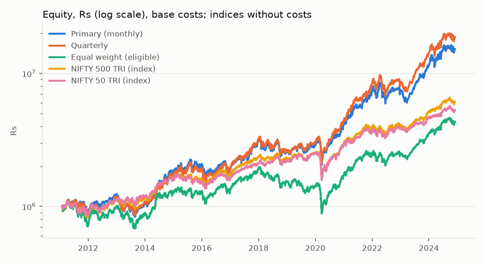
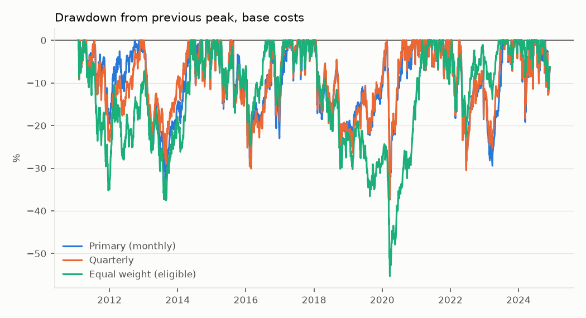
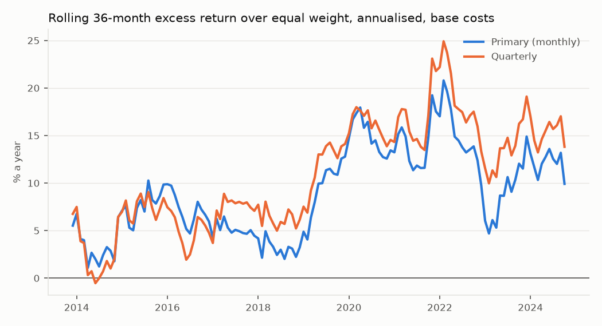
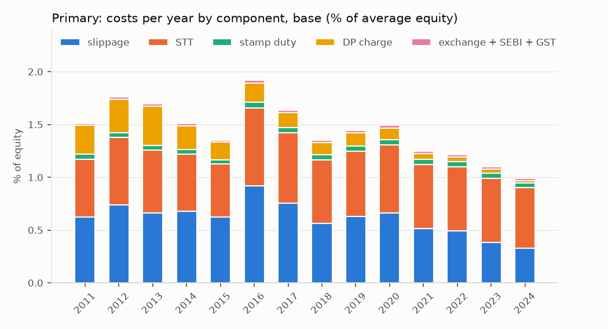

# Backtest report

**Hypothetical backtest, development period only (Jan 2011 to Oct 2024); holdout locked. Not investment advice.**

Simulated from 2011-02-01 to 2024-12-02 with Rs 1,000,000. Monthly returns run between execution closes. Costs are assumptions marked VERIFY in the config. Sharpe uses a 6.5% risk-free rate (VERIFY).

## Reading

- **Primary vs equal weight, after base costs.** The primary beats the equal-weight benchmark: CAGR 21.80% vs 11.22%, Sharpe 0.72 vs 0.31. The mean monthly difference is 0.75% (Newey-West t = 2.91, statistically significant at the 5% level), positive in 60% of months. Alpha on equal weight is 11.21% a year (t = 3.72, beta 0.84); alpha on NIFTY 500 TRI is 6.73% a year (t = 1.79, beta 1.07).
- **Risk.** Maximum drawdown -37.38% (2020-02-20 to 2020-03-23) against -55.32% for equal weight; worst month -23.54% (2020-02).
- **Costs.** One-way turnover 3.1x a year; costs 1.28% of equity a year at base (1.81% at high). Break-even: the primary's excess over equal weight reaches zero at about 27.2x the base slippage. The equal-weight benchmark pays the same multiple.
- **Quarterly.** CAGR 23.63%, Sharpe 0.79, turnover 2.0x, costs 0.82% a year; difference vs equal weight 0.88% a month (t = 3.30). It keeps more of the excess than the monthly version after costs.
- **Overfitting check.** Deflated Sharpe ratio (2 trials): primary 0.99, quarterly 1.00 (probability that the true Sharpe exceeds the best of 2 trials under the null).
- **Concentration.** The top stock gives 5% of the primary's total P&L, the top 5 18%, the top 10 31%. Largest sector weight at a rebalance: mean 21%, maximum 23%.

## Summary (all scenarios; indices without costs)

| strategy | scenario | cagr | vol | sharpe | sortino | max_drawdown | peak | trough | calmar | worst_month | worst_month_date | turnover | avg_holdings | mean_largest_sector_weight | max_sector_weight | cost_total_pct_yr | end_equity |
|---|---|---|---|---|---|---|---|---|---|---|---|---|---|---|---|---|---|
| primary | zero | 0.2359 | 0.223 | 0.7866 | 1.2442 | -0.3731 | 2020-02-20 | 2020-03-23 | 0.6321 | -0.2343 | 2020-02 | 3.0889 | 30.0 | 0.2133 | 0.2333 | 0.0 | 18719902.8113 |
| primary | base | 0.218 | 0.2229 | 0.721 | 1.1243 | -0.3738 | 2020-02-20 | 2020-03-23 | 0.5834 | -0.2354 | 2020-02 | 3.0854 | 30.0 | 0.2133 | 0.2337 | 0.0128 | 15283129.6907 |
| primary | high | 0.2105 | 0.2228 | 0.6931 | 1.0742 | -0.3789 | 2018-01-23 | 2020-03-23 | 0.5557 | -0.2359 | 2020-02 | 3.0839 | 30.0 | 0.2133 | 0.2339 | 0.0181 | 14017783.2715 |
| quarterly | zero | 0.2474 | 0.2242 | 0.8254 | 1.326 | -0.3698 | 2020-02-20 | 2020-03-23 | 0.6689 | -0.2228 | 2020-02 | 2.0233 | 30.0 | 0.2095 | 0.2333 | 0.0 | 21285180.7783 |
| quarterly | base | 0.2363 | 0.2239 | 0.7859 | 1.252 | -0.371 | 2018-01-23 | 2020-03-23 | 0.637 | -0.2248 | 2020-02 | 2.0205 | 30.0 | 0.2096 | 0.2339 | 0.0082 | 18782536.0784 |
| quarterly | high | 0.2315 | 0.2238 | 0.7686 | 1.22 | -0.3754 | 2018-01-23 | 2020-03-23 | 0.6168 | -0.2257 | 2020-02 | 2.0193 | 30.0 | 0.2096 | 0.2342 | 0.0115 | 17782986.4076 |
| equal_weight | zero | 0.1371 | 0.2292 | 0.4035 | 0.601 | -0.5319 | 2018-01-11 | 2020-03-23 | 0.2577 | -0.2853 | 2020-02 | 0.8193 | 295.1325 | 0.1941 | 0.2434 | 0.0 | 5912526.9864 |
| equal_weight | base | 0.1122 | 0.2289 | 0.3065 | 0.4471 | -0.5532 | 2018-01-11 | 2020-03-23 | 0.2028 | -0.2878 | 2020-02 | 0.8249 | 295.1325 | 0.1941 | 0.243 | 0.0206 | 4345396.8659 |
| equal_weight | high | 0.1092 | 0.2288 | 0.2946 | 0.4286 | -0.5557 | 2018-01-11 | 2020-03-23 | 0.1965 | -0.2881 | 2020-02 | 0.8257 | 295.1325 | 0.1941 | 0.2429 | 0.0232 | 4181207.0885 |
| primary | base_whole_shares | 0.2181 | 0.2221 | 0.7227 | 1.128 | -0.3728 | 2020-02-20 | 2020-03-23 | 0.5849 | -0.2348 | 2020-02 | 3.0646 | 29.994 | 0.2125 | 0.2336 | 0.0127 | 15290562.1329 |
| quarterly | base_whole_shares | 0.2364 | 0.2232 | 0.7878 | 1.2559 | -0.368 | 2018-01-23 | 2020-03-23 | 0.6424 | -0.2242 | 2020-02 | 2.0117 | 29.9821 | 0.2088 | 0.2339 | 0.0081 | 18793195.6962 |
| NIFTY 500 TRI (index) | no costs | 0.1401 | 0.1709 | 0.4889 |  | -0.3811 | 2020-01-17 | 2020-03-23 |  | -0.2613 |  |  |  |  |  |  |  |
| NIFTY 50 TRI (index) | no costs | 0.1282 | 0.1655 | 0.4356 |  | -0.3827 | 2020-01-14 | 2020-03-23 |  | -0.2566 |  |  |  |  |  |  |  |

## Against equal weight (same cost scenario)

| strategy | scenario | diff_mean | diff_nw_t | share_positive | alpha_ew_annual | alpha_ew_t | beta_ew | beta_ew_t | alpha_n500_annual | alpha_n500_t | beta_n500 | beta_n500_t |
|---|---|---|---|---|---|---|---|---|---|---|---|---|
| primary | zero | 0.0069 | 2.6673 | 0.5843 | 0.1083 | 3.5889 | 0.8372 | 15.6378 | 0.082 | 2.1838 | 1.0676 | 17.0999 |
| primary | base | 0.0075 | 2.9107 | 0.6024 | 0.1121 | 3.7211 | 0.8379 | 15.6955 | 0.0673 | 1.7891 | 1.0666 | 17.0946 |
| primary | high | 0.0072 | 2.7933 | 0.5904 | 0.1082 | 3.5855 | 0.8378 | 15.6879 | 0.0611 | 1.6218 | 1.066 | 17.0914 |
| quarterly | zero | 0.0077 | 2.8746 | 0.6205 | 0.1176 | 3.9087 | 0.8392 | 15.5322 | 0.0912 | 2.4245 | 1.0705 | 16.8073 |
| quarterly | base | 0.0088 | 3.2954 | 0.6325 | 0.1272 | 4.2257 | 0.8397 | 15.6278 | 0.0821 | 2.1859 | 1.0702 | 16.9637 |
| quarterly | high | 0.0087 | 3.257 | 0.6386 | 0.1255 | 4.1696 | 0.8396 | 15.6399 | 0.0781 | 2.0809 | 1.0701 | 17.0298 |

## Break-even slippage multiple

Primary: 27.19x; quarterly: 94.94x base slippage (statutory charges on; linear between runs).

| multiple | primary_minus_ew | quarterly_minus_ew |
|---|---|---|
| 0.0 | 0.00784 | 0.00892 |
| 1.0 | 0.00754 | 0.00882 |
| 2.0 | 0.00725 | 0.00872 |
| 4.0 | 0.00666 | 0.00851 |
| 8.0 | 0.00549 | 0.00811 |
| 16.0 | 0.0032 | 0.00737 |

## Calendar-year returns (base costs; 2011 from February, 2024 to 2 December)

| year | primary | quarterly | equal_weight | NIFTY 500 TRI | NIFTY 50 TRI |
|---|---|---|---|---|---|
| 2011.0 | -0.0831 | -0.1389 | -0.2853 | -0.1646 | -0.1374 |
| 2012.0 | 0.3086 | 0.3539 | 0.3754 | 0.3348 | 0.2943 |
| 2013.0 | -0.1231 | -0.0668 | -0.0903 | 0.0482 | 0.0807 |
| 2014.0 | 0.7376 | 0.6061 | 0.4412 | 0.393 | 0.329 |
| 2015.0 | 0.1362 | 0.1166 | 0.0125 | 0.0022 | -0.0301 |
| 2016.0 | -0.1069 | -0.045 | 0.0045 | 0.0512 | 0.0439 |
| 2017.0 | 0.6728 | 0.7164 | 0.4708 | 0.3765 | 0.3027 |
| 2018.0 | -0.165 | -0.1726 | -0.1963 | -0.0214 | 0.0464 |
| 2019.0 | 0.119 | 0.1567 | -0.0828 | 0.0897 | 0.1348 |
| 2020.0 | 0.4153 | 0.4197 | 0.2038 | 0.1789 | 0.1614 |
| 2021.0 | 0.8245 | 0.9598 | 0.4566 | 0.316 | 0.2559 |
| 2022.0 | 0.0028 | 0.0178 | 0.0041 | 0.0425 | 0.0569 |
| 2023.0 | 0.5332 | 0.6247 | 0.4126 | 0.2691 | 0.213 |
| 2024.0 | 0.3304 | 0.3364 | 0.2319 | 0.1862 | 0.1303 |

## The 10 worst months of the primary

| HistoricalDate | primary | equal_weight | NIFTY 500 TRI |
|---|---|---|---|
| 2020-02 | -0.2354 | -0.2878 | -0.2613 |
| 2018-08 | -0.1485 | -0.1479 | -0.0756 |
| 2013-01 | -0.1414 | -0.1123 | -0.0572 |
| 2022-05 | -0.1125 | -0.0619 | -0.0475 |
| 2016-10 | -0.112 | -0.0881 | -0.0611 |
| 2015-07 | -0.1119 | -0.1147 | -0.0843 |
| 2016-01 | -0.1062 | -0.0782 | -0.0501 |
| 2019-06 | -0.0933 | -0.1073 | -0.0773 |
| 2011-10 | -0.0906 | -0.1058 | -0.0697 |
| 2022-12 | -0.0847 | -0.0484 | -0.0434 |

## Deflated Sharpe ratio (inputs)

| trial | sharpe_monthly | sharpe_annual | trials | var_of_trial_sharpes | expected_max_sharpe_null | skew | kurtosis | months | deflated_sharpe |
|---|---|---|---|---|---|---|---|---|---|
| primary | 0.2081 | 0.721 | 2 | 0.0002 | 0.0069 | -0.4994 | 3.8475 | 166 | 0.9924 |
| quarterly | 0.2269 | 0.7859 | 2 | 0.0002 | 0.0069 | -0.4405 | 3.7075 | 166 | 0.996 |

## Profit concentration (primary, base; P&L gross of costs)

| top | share_of_total_pnl | stocks |
|---|---|---|
| 1 | 0.0541 | RVNL |
| 5 | 0.1788 | RVNL, PFC, COCHINSHIP, TATAELXSI, KALYANKJIL |
| 10 | 0.306 | RVNL, PFC, COCHINSHIP, TATAELXSI, KALYANKJIL |

## Costs per year, % of average equity (base)

| strategy | cost_slippage_pct_yr | cost_stt_pct_yr | cost_exchange_pct_yr | cost_sebi_pct_yr | cost_stamp_pct_yr | cost_gst_pct_yr | cost_dp_pct_yr | cost_brokerage_pct_yr | cost_total_pct_yr |
|---|---|---|---|---|---|---|---|---|---|
| primary | 0.00513 | 0.00617 | 0.00018 | 1e-05 | 0.00046 | 3e-05 | 0.00086 | 0.0 | 0.01285 |
| quarterly | 0.00332 | 0.00404 | 0.00012 | 0.0 | 0.0003 | 2e-05 | 0.00035 | 0.0 | 0.00816 |
| equal_weight | 0.00211 | 0.00165 | 5e-05 | 0.0 | 0.00013 | 1e-05 | 0.01665 | 0.0 | 0.0206 |

## Sector weights (primary, base)

| sector | average_weight | max_weight |
|---|---|---|
| Financial Services | 0.1342 | 0.2337 |
| Healthcare | 0.0984 | 0.2336 |
| Capital Goods | 0.097 | 0.2336 |
| Information Technology | 0.0874 | 0.2337 |
| Fast Moving Consumer Goods | 0.0817 | 0.2336 |
| Chemicals | 0.0624 | 0.2337 |
| Automobile and Auto Components | 0.061 | 0.2337 |
| Consumer Durables | 0.0581 | 0.2002 |
| Metals & Mining | 0.0428 | 0.2336 |
| Oil Gas & Consumable Fuels | 0.0408 | 0.1668 |
| Construction | 0.0349 | 0.2 |
| Textiles | 0.0337 | 0.1335 |
| Consumer Services | 0.0305 | 0.1 |
| Power | 0.0269 | 0.1335 |
| Telecommunication | 0.0267 | 0.1001 |
| Services | 0.0263 | 0.1001 |
| Construction Materials | 0.0179 | 0.1668 |
| Media Entertainment & Publication | 0.0145 | 0.0668 |
| Realty | 0.0132 | 0.0999 |
| Unclassified | 0.0074 | 0.0667 |
| Diversified | 0.0024 | 0.0334 |
| Forest Materials | 0.0018 | 0.0334 |

## Whole shares vs fractional (base)

| strategy | scenario | cagr | sharpe | max_drawdown | turnover | end_equity |
|---|---|---|---|---|---|---|
| primary | base | 0.218 | 0.721 | -0.3738 | 3.0854 | 15283129.6907 |
| quarterly | base | 0.2363 | 0.7859 | -0.371 | 2.0205 | 18782536.0784 |
| primary | base_whole_shares | 0.2181 | 0.7227 | -0.3728 | 3.0646 | 15290562.1329 |
| quarterly | base_whole_shares | 0.2364 | 0.7878 | -0.368 | 2.0117 | 18793195.6962 |

## Charts

