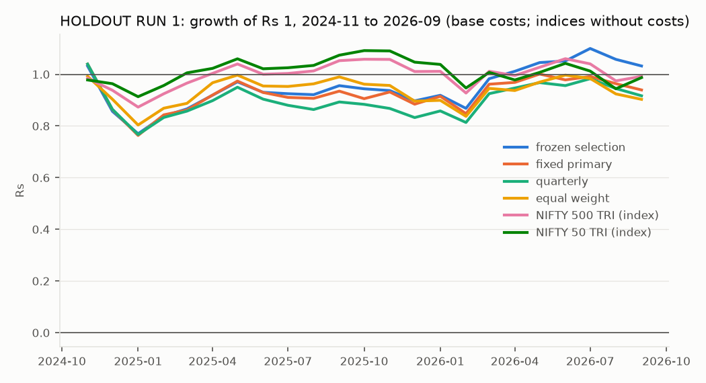

# HOLDOUT RUN 1

**Hypothetical backtest. Not investment advice.**

Signal months 2024-11 to 2026-09 (23 months scored), each strategy starting in cash, base costs. Frozen selection: score|N50|quarterly (chosen on the full development period, committed before this run).

## Reading

- Frozen selection: 1.67% a year, Sharpe -0.10; equal weight -5.19%. Mean monthly difference vs equal weight 0.62% (Newey-West t = 1.56), positive in 65% of months.
- Low power: with 23 months, a mean monthly difference needs to be about 1.14% to reach t = 2. A result below that is consistent with both no edge and the development-period edge.
- Mean IC of the frozen signal: 0.020 (t = 0.94).

| strategy | months | cagr | sharpe | max_drawdown_monthly | diff_vs_ew | diff_nw_t | diff_share_positive | detectable_diff_t2 | mean_ic | ic_nw_t |
|---|---|---|---|---|---|---|---|---|---|---|
| frozen selection | 23 | 0.0167 | -0.1043 | -0.2537 | 0.0062 | 1.5633 | 0.6522 | 0.0114 | 0.0196 | 0.9385 |
| fixed primary | 23 | -0.0321 | -0.2985 | -0.2657 | 0.0024 | 0.591 | 0.5217 | 0.0119 |  |  |
| quarterly | 23 | -0.0443 | -0.3805 | -0.2623 | 0.0011 | 0.2442 | 0.5652 | 0.0125 |  |  |
| equal weight | 23 | -0.0519 | -0.4944 | -0.1901 |  |  |  |  |  |  |
| NIFTY 500 TRI (index) | 23 | -0.0042 | -0.3668 | -0.1236 | 0.0035 | 0.7253 | 0.5217 | 0.0098 |  |  |
| NIFTY 50 TRI (index) | 23 | -0.0067 | -0.4235 | -0.1353 | 0.0031 | 0.4123 | 0.5217 | 0.0152 |  |  |

