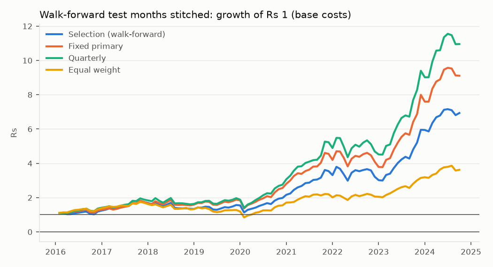

# Walk-forward

**Hypothetical backtest; development period only; holdout locked. Not investment advice.**

9 folds, test months 2016-02 to 2024-10 (105 months). Each test window starts in cash (mean cost of entering: 0.21% of capital for the selection, 0.21% for equal weight). Base costs. 18 trials.

## Reading

- The stitched out-of-sample selection earns 24.77% a year (Sharpe 0.80) against 15.84% for equal weight; mean monthly difference 0.68% (Newey-West t = 2.04). The fixed primary with no selection: 28.72%, Sharpe 0.94, difference 0.93% (t = 2.89). Selection does not improve on the fixed rule out of sample.
- In-sample to out-of-sample Sharpe changes by +0.39 on average across folds (in-sample mean 0.61, out-of-sample mean 0.99).
- Mean IC of the chosen signal on test months: 0.038 (t = 2.35).
- Deflated Sharpe at 18 trials: fixed primary 0.98, best grid combination 0.99, stitched selection 0.97.

## Folds

| fold | train_first | train_last | embargo | test_first | test_last | test_months | chosen | signal | n | rebalance | is_sharpe | oos_sharpe | train_ic | primary_oos_sharpe | oos_ic |
|---|---|---|---|---|---|---|---|---|---|---|---|---|---|---|---|
| 1 | 2011-01 | 2015-12 | 2016-01 | 2016-02 | 2017-01 | 12 | z_12_1|N20|monthly | z_12_1 | 20 | monthly | 0.548 | 0.77 | 0.073 | 1.026 | -0.037 |
| 2 | 2011-01 | 2016-12 | 2017-01 | 2017-02 | 2018-01 | 12 | z_12_1|N50|quarterly | z_12_1 | 50 | quarterly | 0.529 | 1.521 | 0.057 | 1.124 | 0.069 |
| 3 | 2011-01 | 2017-12 | 2018-01 | 2018-02 | 2019-01 | 12 | z_12_1|N50|quarterly | z_12_1 | 50 | quarterly | 0.728 | -1.116 | 0.055 | -0.356 | 0.06 |
| 4 | 2011-01 | 2018-12 | 2019-01 | 2019-02 | 2020-01 | 12 | score|N50|monthly | score | 50 | monthly | 0.441 | 0.537 | 0.048 | 0.561 | 0.15 |
| 5 | 2011-01 | 2019-12 | 2020-01 | 2020-02 | 2021-01 | 12 | score|N50|monthly | score | 50 | monthly | 0.484 | 0.96 | 0.055 | 1.223 | -0.055 |
| 6 | 2011-01 | 2020-12 | 2021-01 | 2021-02 | 2022-01 | 12 | score|N50|quarterly | score | 50 | quarterly | 0.534 | 2.094 | 0.046 | 1.867 | 0.072 |
| 7 | 2011-01 | 2021-12 | 2022-01 | 2022-02 | 2023-01 | 12 | z_12_1|N30|monthly | z_12_1 | 30 | monthly | 0.753 | -0.381 | 0.057 | -0.507 | -0.014 |
| 8 | 2011-01 | 2022-12 | 2023-01 | 2023-02 | 2024-01 | 12 | score|N50|quarterly | score | 50 | quarterly | 0.632 | 3.419 | 0.044 | 3.009 | 0.087 |
| 9 | 2011-01 | 2023-12 | 2024-01 | 2024-02 | 2024-10 | 9 | score|N50|quarterly | score | 50 | quarterly | 0.804 | 1.138 | 0.047 | 1.286 | -0.003 |

## Stitched test months

| strategy | months | cagr | sharpe | max_drawdown_monthly | turnover | entry_cost_pct | diff_vs_ew | diff_nw_t | diff_share_positive | mean_ic | ic_nw_t |
|---|---|---|---|---|---|---|---|---|---|---|---|
| selection | 105 | 0.2477 | 0.7961 | -0.3588 | 2.4147 | 0.0021 | 0.0068 | 2.042 | 0.581 | 0.0377 | 2.3529 |
| primary | 105 | 0.2872 | 0.9442 | -0.27 | 3.3408 | 0.002 | 0.0093 | 2.8853 | 0.5905 |  |  |
| quarterly | 105 | 0.3147 | 1.0244 | -0.2892 | 2.2638 | 0.002 | 0.0112 | 3.4682 | 0.619 |  |  |
| equal_weight | 105 | 0.1584 | 0.514 | -0.5162 | 1.2166 | 0.0021 |  |  |  |  |  |
| NIFTY 500 TRI (index) | 105 | 0.178 | 0.6864 | -0.3137 |  |  | 0.0008 | 0.3585 | 0.5048 |  |  |

## How often each parameter was chosen

| value | signal | holdings | rebalance |
|---|---|---|---|
| score | 5 | 0 | 0 |
| z_12_1 | 4 | 0 | 0 |
| 50 | 0 | 7 | 0 |
| 20 | 0 | 1 | 0 |
| 30 | 0 | 1 | 0 |
| quarterly | 0 | 0 | 5 |
| monthly | 0 | 0 | 4 |

## Grid on the full development period

| name | sharpe | ic | turnover |
|---|---|---|---|
| score|N50|quarterly | 0.8216 | 0.0442 | 1.7205 |
| z_12_1|N50|quarterly | 0.7881 | 0.0518 | 1.4828 |
| score|N30|quarterly | 0.7859 | 0.0442 | 2.0555 |
| z_12_1|N30|monthly | 0.7856 | 0.0518 | 2.6017 |
| score|N50|monthly | 0.7733 | 0.0442 | 2.6782 |
| z_12_1|N20|monthly | 0.7676 | 0.0518 | 2.9597 |
| z_12_1|N30|quarterly | 0.7618 | 0.0518 | 1.727 |
| z_12_1|N50|monthly | 0.7454 | 0.0518 | 2.1872 |
| score|N20|quarterly | 0.7391 | 0.0442 | 2.1927 |
| score|N20|monthly | 0.7355 | 0.0442 | 3.534 |
| score|N30|monthly | 0.721 | 0.0442 | 3.1329 |
| z_12_1|N20|quarterly | 0.7137 | 0.0518 | 1.8725 |
| z_6_1|N50|quarterly | 0.7061 | 0.0339 | 2.3073 |
| z_6_1|N50|monthly | 0.6882 | 0.0339 | 3.6467 |
| z_6_1|N30|quarterly | 0.6812 | 0.0339 | 2.6034 |
| z_6_1|N20|monthly | 0.6638 | 0.0339 | 4.7589 |
| z_6_1|N20|quarterly | 0.6542 | 0.0339 | 2.7551 |
| z_6_1|N30|monthly | 0.6081 | 0.0339 | 4.2281 |

## Deflated Sharpe (18 trials; inputs)

| series | trials | sharpe_monthly | sharpe_annual | var_trial_sharpes | expected_max_sharpe_null | skew | kurtosis | months | deflated_sharpe |
|---|---|---|---|---|---|---|---|---|---|
| fixed primary, full development | 18 | 0.2081 | 0.721 | 0.0003 | 0.0298 | -0.4994 | 3.8475 | 166 | 0.9842 |
| best grid combination, full development | 18 | 0.2372 | 0.8216 | 0.0003 | 0.0298 | -0.6053 | 4.2312 | 166 | 0.9927 |
| stitched selection, out of sample | 18 | 0.2298 | 0.7961 | 0.0003 | 0.0298 | -0.7762 | 5.2589 | 105 | 0.9668 |

