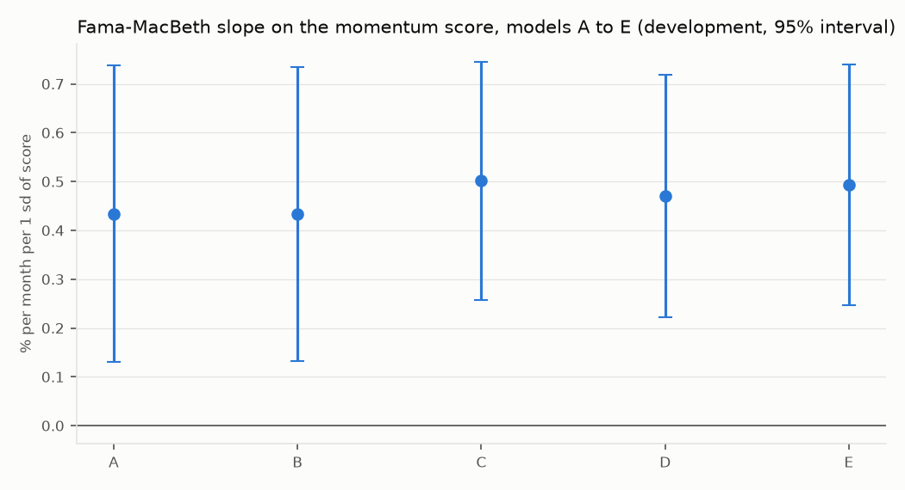
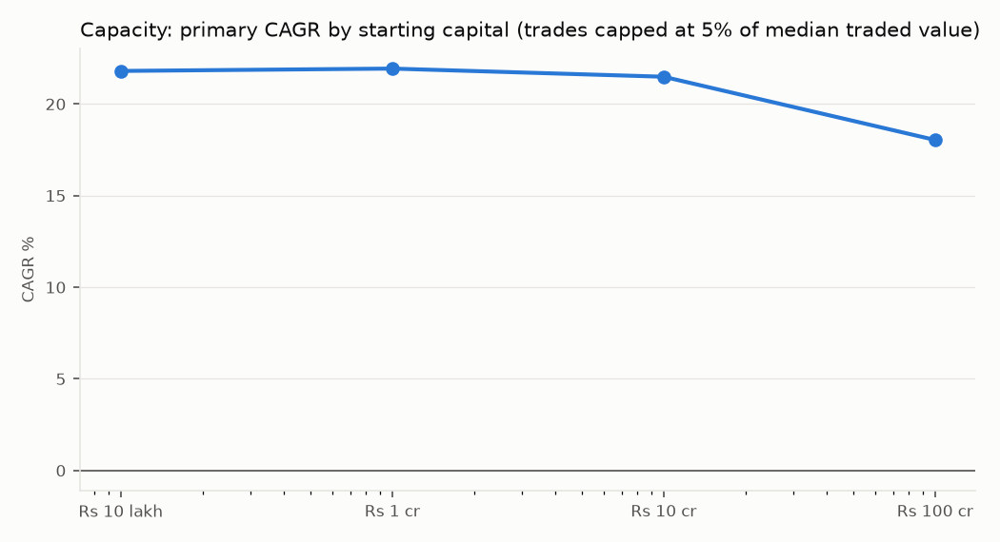
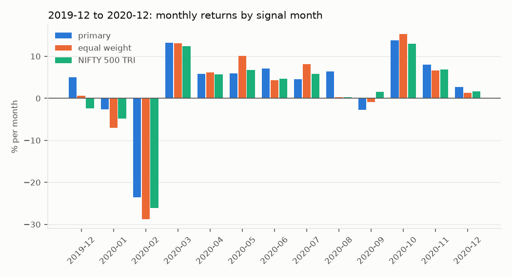

# Institutional tests

**Hypothetical backtest; development period only; holdout not used. Not investment advice.**

**The edge shrinks substantially under controls or spanning.** The momentum slope goes from 0.43% a month (t = 2.80, model A) to 0.49% (t = 3.91) with all controls (model E), a change of +14%. The primary's alpha over the risk-free rate goes from 5.81% a year (t = 2.00) against IIMA's market factor alone to 0.67% (t = 0.26) against market, SMB, HML and WML (-88%).

## Reading

- **Fama-MacBeth.** Adding size (B), beta and volatility (C), sector dummies (D) and last month's return (E) leaves the score slope at A 0.43% (t = 2.80), B 0.43% (t = 2.83), C 0.50% (t = 4.03), D 0.47% (t = 3.72), E 0.49% (t = 3.91).
- **Neutral variants.** Sector-neutral: CAGR 20.40%, difference vs equal weight 0.67% a month (t = 3.09); size-neutral: 22.74%, 0.83% (t = 3.33); primary 21.80%, 0.75% (t = 2.91). On walk-forward test months: sector-neutral 0.92% (t = 3.27), size-neutral 1.08% (t = 3.58).
- **Exposures.** Holdings sit at the 53% traded-value percentile (universe 50%); beta 1.17 vs 1.13; volatility 44.65% vs 38.42%.
- **Capacity.** Rs 0.1 crore: CAGR 21.80%, excess vs equal weight 0.75% a month (t = 2.91), 0% of trades capped; Rs 1 crore: CAGR 21.93%, excess vs equal weight 0.76% a month (t = 2.94), 0% of trades capped; Rs 10 crore: CAGR 21.49%, excess vs equal weight 0.72% a month (t = 2.88), 20% of trades capped; Rs 100 crore: CAGR 18.04%, excess vs equal weight 0.42% a month (t = 1.70), 65% of trades capped.
- **States.** After a rising market: 0.89% a month over equal weight (t = 3.22, 134 months); after a falling market: 0.17% (t = 0.33, 32 months). Worst month in the 2020 episode: 2020-05 (-4.06% vs equal weight).
- **Spanning (IIMA factors, 166 overlapping months, 2011-02 to 2024-11).** Primary: four-factor alpha 0.67% a year (t = 0.26), WML loading 0.24 (t = 3.69). Q5 minus Q1: alpha 0.57% a year (t = 0.15), WML loading 0.90 (t = 9.34); correlation with WML 0.76. IIMA's MF is taken as the market factor (market minus risk-free); VERIFY against the library's notes.

## Fama-MacBeth

| model | variable | mean_slope | nw_t | months | sample |
|---|---|---|---|---|---|
| A | score | 0.0043 | 2.8024 | 166 | development |
| B | score | 0.0043 | 2.8262 | 166 | development |
| B | log_tv | -0.001 | -1.3861 | 166 | development |
| C | score | 0.005 | 4.034 | 166 | development |
| C | log_tv | -0.0017 | -2.2174 | 166 | development |
| C | beta | 0.0045 | 1.0252 | 166 | development |
| C | vol | -0.0372 | -2.9037 | 166 | development |
| D | beta | 0.0057 | 1.8223 | 166 | development |
| D | log_tv | -0.0018 | -2.4769 | 166 | development |
| D | score | 0.0047 | 3.7215 | 166 | development |
| D | vol | -0.0439 | -3.2857 | 166 | development |
| E | beta | 0.0044 | 1.3774 | 166 | development |
| E | log_tv | -0.0017 | -2.4467 | 166 | development |
| E | prev_ret | -0.0044 | -0.4622 | 166 | development |
| E | score | 0.0049 | 3.9138 | 166 | development |
| E | vol | -0.0425 | -3.1666 | 166 | development |
| A | score | 0.0049 | 2.7686 | 105 | walk-forward test months |
| B | score | 0.0049 | 2.8656 | 105 | walk-forward test months |
| B | log_tv | -0.0014 | -1.8656 | 105 | walk-forward test months |
| C | score | 0.0049 | 3.4632 | 105 | walk-forward test months |
| C | log_tv | -0.0025 | -3.142 | 105 | walk-forward test months |
| C | beta | 0.0101 | 2.0354 | 105 | walk-forward test months |
| C | vol | -0.0415 | -2.4366 | 105 | walk-forward test months |
| D | beta | 0.0105 | 3.1186 | 105 | walk-forward test months |
| D | log_tv | -0.0026 | -3.3327 | 105 | walk-forward test months |
| D | score | 0.005 | 3.4639 | 105 | walk-forward test months |
| D | vol | -0.0407 | -2.487 | 105 | walk-forward test months |
| E | beta | 0.0096 | 2.7628 | 105 | walk-forward test months |
| E | log_tv | -0.0025 | -3.122 | 105 | walk-forward test months |
| E | prev_ret | -0.013 | -1.35 | 105 | walk-forward test months |
| E | score | 0.0054 | 3.7801 | 105 | walk-forward test months |
| E | vol | -0.0423 | -2.5442 | 105 | walk-forward test months |

### Model D score slope by year

| index | score_slope | count |
|---|---|---|
| 2011.0 | 0.0047 | 12.0 |
| 2012.0 | 0.0006 | 12.0 |
| 2013.0 | 0.0 | 12.0 |
| 2014.0 | 0.0115 | 12.0 |
| 2015.0 | 0.0043 | 12.0 |
| 2016.0 | -0.003 | 12.0 |
| 2017.0 | 0.0045 | 12.0 |
| 2018.0 | 0.0062 | 12.0 |
| 2019.0 | 0.012 | 12.0 |
| 2020.0 | 0.0005 | 12.0 |
| 2021.0 | 0.0092 | 12.0 |
| 2022.0 | 0.0048 | 12.0 |
| 2023.0 | 0.0071 | 12.0 |
| 2024.0 | 0.0035 | 10.0 |

## Neutral variants (base costs)

| strategy | cagr | sharpe | max_drawdown | turnover | cost_pct_yr | diff_vs_ew | diff_nw_t | wf_diff_vs_ew | wf_diff_nw_t | wf_months |
|---|---|---|---|---|---|---|---|---|---|---|
| primary | 0.218 | 0.721 | -0.3738 | 3.0854 | 0.0128 | 0.0075 | 2.9107 | 0.0093 | 2.8853 | 105 |
| sector-neutral | 0.204 | 0.6515 | -0.4002 | 3.2558 | 0.0138 | 0.0067 | 3.0859 | 0.0092 | 3.2735 | 105 |
| size-neutral | 0.2274 | 0.7457 | -0.3906 | 3.3037 | 0.0139 | 0.0083 | 3.3337 | 0.0108 | 3.5783 | 105 |

## Exposures of the primary

| index | value |
|---|---|
| holdings_tv_percentile | 0.5257 |
| universe_tv_percentile | 0.5017 |
| holdings_beta | 1.1733 |
| universe_beta | 1.13 |
| holdings_vol | 0.4465 |
| universe_vol | 0.3842 |
| share_in_tercile_1 | 0.2845 |
| share_in_tercile_2 | 0.3719 |
| share_in_tercile_3 | 0.3436 |

### Sector over/underweights vs the eligible universe (top 5 each)

| sector | over/underweight |
|---|---|
| Information Technology | 0.0279 |
| Capital Goods | 0.02 |
| Chemicals | 0.019 |
| Consumer Durables | 0.014 |
| Textiles | 0.0129 |
| Financial Services | -0.0599 |
| Oil Gas & Consumable Fuels | -0.0163 |
| Power | -0.0135 |
| Construction Materials | -0.0099 |
| Realty | -0.0087 |

## Capacity

| capital | cagr | sharpe | excess_vs_ew | excess_nw_t | share_trades_capped | end_equity |
|---|---|---|---|---|---|---|
| 1000000.0 | 0.218 | 0.721 | 0.0075 | 2.9107 | 0.0 | 15283129.6907 |
| 10000000.0 | 0.2193 | 0.7261 | 0.0076 | 2.9436 | 0.0021 | 155073358.9839 |
| 100000000.0 | 0.2149 | 0.7214 | 0.0072 | 2.8834 | 0.1995 | 1474354403.3554 |
| 1000000000.0 | 0.1804 | 0.6656 | 0.0042 | 1.6983 | 0.6453 | 9910093283.5591 |

## Momentum states

| state | months | mean_diff | nw_t | share_positive |
|---|---|---|---|---|
| NIFTY 500 TRI up over the past 12 months | 134 | 0.0089 | 3.2237 | 0.6194 |
| down over the past 12 months | 32 | 0.0017 | 0.3338 | 0.5312 |

### 2020 episode

| HistoricalDate | primary | equal_weight | NIFTY 500 TRI | primary_minus_ew |
|---|---|---|---|---|
| 2019-12 | 0.0495 | 0.0066 | -0.0239 | 0.0429 |
| 2020-01 | -0.0257 | -0.0702 | -0.0481 | 0.0445 |
| 2020-02 | -0.2354 | -0.2878 | -0.2613 | 0.0524 |
| 2020-03 | 0.1327 | 0.1306 | 0.1236 | 0.0022 |
| 2020-04 | 0.0577 | 0.0612 | 0.0565 | -0.0035 |
| 2020-05 | 0.0598 | 0.1004 | 0.0672 | -0.0406 |
| 2020-06 | 0.0706 | 0.0429 | 0.0461 | 0.0276 |
| 2020-07 | 0.0458 | 0.0808 | 0.0583 | -0.035 |
| 2020-08 | 0.0637 | 0.0031 | 0.0025 | 0.0606 |
| 2020-09 | -0.0272 | -0.0095 | 0.0155 | -0.0177 |
| 2020-10 | 0.138 | 0.1529 | 0.1299 | -0.0149 |
| 2020-11 | 0.0806 | 0.0661 | 0.0685 | 0.0145 |
| 2020-12 | 0.0266 | 0.0127 | 0.0171 | 0.0138 |

## Spanning

| series | months | first | last | alpha_annual | alpha_t | b_MF | t_MF | b_SMB | t_SMB | b_HML | t_HML | b_WML | t_WML | capm_alpha_annual | capm_alpha_t | mean_annual | corr_with_wml |
|---|---|---|---|---|---|---|---|---|---|---|---|---|---|---|---|---|---|
| primary minus RF | 166 | 2011-02 | 2024-11 | 0.0067 | 0.2616 | 1.1053 | 21.7668 | 0.2725 | 4.1666 | 0.2152 | 3.3958 | 0.2419 | 3.6937 | 0.0581 | 2.0034 | 0.1599 |  |
| Q5 minus Q1 | 166 | 2011-02 | 2024-11 | 0.0057 | 0.15 | -0.0459 | -0.4272 | -0.0006 | -0.006 | -0.044 | -0.4477 | 0.8951 | 9.3377 | 0.1787 | 3.7335 | 0.1379 | 0.7638 |

