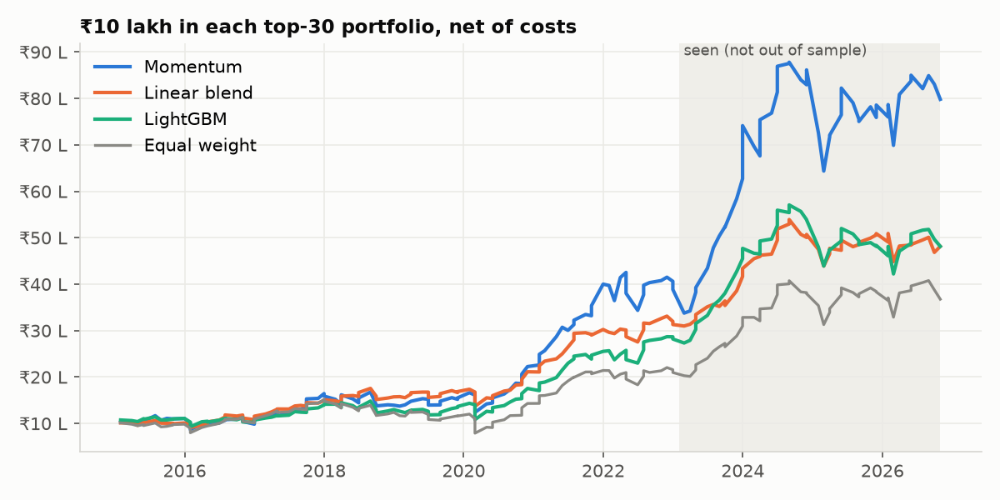

# Does ML beat a linear factor blend on point-in-time Nifty 500?

Does LightGBM rank Nifty 500 stocks better than an equal-weight blend of the same 12 features, after costs? On the point-in-time Nifty 500 from the momentum project (62k stock-months, walk-forward from 2015): **no edge after costs. LightGBM ranked stocks about as well as a linear blend but traded about twice as much.** LightGBM minus the linear blend was −0.06% a month in development (t = −0.23) and +0.28% in the seen period (t = 0.59), and its alpha against the IIMA four factors is 1.4% a year (t = 0.56). Plain momentum did best: 0.67% a month over equal weight in development (t = 2.08).

*Hypothetical backtest. Costs are assumptions. Not investment advice.*

| Period | Model | IC (t) | Excess over equal weight, per month (t) | Sharpe | Turnover (one-way, ×/yr) | Cost drag (%/yr) |
|---|---|---:|---:|---:|---:|---:|
| Development 2015–2022 | Momentum | 0.040 (2.34) | 0.67% (2.08) | 0.84 | 3.18 | 1.29% |
| | Linear blend (12 features) | 0.064 (2.99) | 0.30% (1.00) | 1.01 | 3.35 | 1.09% |
| | LightGBM | 0.052 (3.60) | 0.25% (0.84) | 0.78 | 7.49 | 3.03% |
| | Equal weight | – | – | 0.53 | 0.94 | 0.44% |
| Seen 2023 to Sep 2026 | Momentum | 0.033 (2.00) | 0.47% (1.10) | 0.89 | 3.52 | 1.12% |
| | Linear blend (12 features) | 0.042 (1.94) | −0.35% (−0.78) | 0.86 | 4.07 | 1.23% |
| | LightGBM | 0.040 (3.19) | −0.07% (−0.28) | 0.89 | 8.62 | 2.97% |
| | Equal weight | – | – | 0.88 | 0.57 | 0.23% |

"Seen" is not out of sample: the momentum results for that period had already been looked at. Source: [results/summary.md](results/summary.md).



SHAP shows what LightGBM learned: about 43% of mean |SHAP| was momentum and 38% low volatility or low beta, with 12% liquidity and size and 7% short-term reversal. The top features were beta, 12-1 momentum, one-month volatility and distance from the 52-week high, so the model mostly rediscovered known factors ([results/feature_importance.csv](results/feature_importance.csv), [results/interactions.csv](results/interactions.csv)).

## Method

At each month-end the universe is the stocks that were Nifty 500 members that day, had a price, and had at least ₹5 crore median traded value (151 to 499 stocks a month). Twelve features (momentum, reversal, volatility, beta, distance from the 52-week high, liquidity, maximum daily return and industry-relative momentum) are ranked to [−0.5, 0.5], and the target is next month's return rank. Three models were fixed in advance with no tuning: the momentum z-blend from the momentum project, a linear blend that takes the sign of each feature's training IC and weights them equally, and LightGBM with fixed settings. Each model's portfolio holds the top 30 at equal weight with a 25% sector cap, keeps a holding while it ranks within 45, and pays 10 bps plus 5/10/20 bps slippage per side.

## Validation

The walk-forward uses an expanding window, retrains every January from 2015, and drops the last training month as an embargo. All three trials are in [results/trial_log.csv](results/trial_log.csv), and the deflated Sharpe of the best model's excess over equal weight is 0.64. Excess returns, IC and the spanning test against the IIMA four factors use Newey-West t-statistics.

## Known issues

Fills are at the signal-date close, so each return runs from t to t+1 with no gap, as specified. The momentum project fills at the next session's close, so the two projects' returns are not directly comparable, and a one-session execution lag was not tested here. Sharpe uses raw monthly returns, not excess over the risk-free rate.

## Limitations

There is no clean out-of-sample period, and the seen period has only 45 months. Costs are assumptions, delisted holdings are valued at their last close, and the spanning test ends in December 2025, the last month in the IIMA file.

## Reproducing

This project reads the momentum project's processed data, so build [momentum_research](../momentum_research) first (or point `MOMENTUM_DIR` at a copy).

```bash
pip install -e .
python scripts/prepare_data.py   # copy inputs into data/, build data/panel.parquet
python scripts/walk_forward.py   # yearly models, predictions, feature importance, SHAP interactions
python scripts/report.py         # portfolios, IC, spanning test, trial log -> results/
```

Code is in `src/mlfactors/` (data, models, portfolio, metrics, report).
