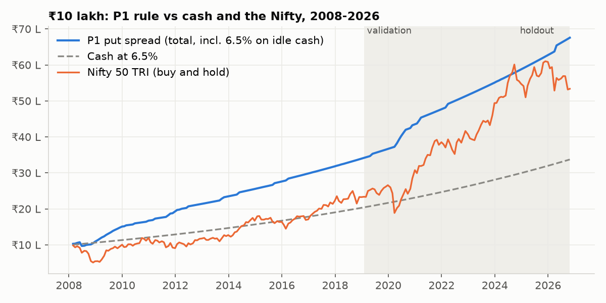

# Systematic Nifty option selling: 18 years of NSE F&O data

Does selling one-month Nifty options earn the variance risk premium after realistic costs, and what do the crash months cost? On NSE's daily F&O bhavcopies from 2008 to 2026, the P1 rule (sell the 0.95/0.90 put spread only when its credit is at least 12% of the spread width) returned **11.8% net CAGR on ₹10 lakh with a Sharpe of 1.12 and a maximum drawdown of −10.0% in design (2008–2018)**, 5.0% a year above 6.5% cash. In validation (2019–2024) it returned 9.7% with a Sharpe of 1.38, 2.9% a year above cash. P1 was chosen after seeing these results, so both periods are in-sample for it. On the 24-month holdout, run once, the frozen e1f1 rule made 7.3% a year against 6.5% for cash and −2.3% for the Nifty.

*Hypothetical backtest on end-of-day data. Costs are assumptions marked VERIFY. Not investment advice.*

| Total CAGR / Sharpe / max drawdown | Design 2008-02 to 2018-12 (132 months) | Validation 2019-02 to 2024-09 (69) | Holdout 2024-11 to 2026-10 (24, run once) |
|---|---:|---:|---:|
| e1f1 (frozen: IV-RV filter + 2×-credit stop) | 9.8% / 0.73 / −11.8% | 9.3% / 1.10 / −4.1% | 7.3% / 1.50 / 0.0% |
| — months traded | 66 | 34 | 5 |
| P1 (credit ≥ 12% of width; chosen after the fact) | 11.8% / 1.12 / −10.0% | 9.7% / 1.38 / 0.0% | 7.8% / 0.71 / 0.0% |
| — months traded | 35 | 10 | 1 |
| Nifty 50 TRI, buy and hold | 10.8% / 0.30 / −49.1% for the whole development period, 2008-02 to 2024-10 | | −2.3% / −0.55 / −13.4% |
| Cash | 6.5% | 6.5% | 6.5% |

Total CAGR includes 6.5% interest on idle capital. For the rules, Sharpe and drawdown use the option-only monthly return with cash months counted as 0, which is close to an excess return over cash; the Nifty's Sharpe is over 6.5% cash. Sources: `results/phase4/summary_{design,validation}_bugfix.csv`, `results/phase4/summary_holdout.csv`, `results/phase5/phase5_report.md`, `results/census/census_report.md`, and the summary in [results/resume_numbers.md](results/resume_numbers.md).



## Method

Each cycle enters at the close of the first trading day after a monthly expiry and holds to the next monthly expiry, cash-settled. Expiries and the settlement price are read from the bhavcopy, never assumed. Positions are sized so that the planned maximum loss is 10% of capital. The work ran in phases: Phase 1 compared a put spread, an iron condor and a strangle; Phase 2 tried delta-based strikes and cheaper hedges; Phase 3 added a stop and a volatility filter and froze e1f1; a census then tested 12 strategy families; Phase 4 tested the premium filter (P1) and an index stop; Phase 5 tested tail hedges. Costs cover STT by date, ₹20 brokerage per order, exchange and SEBI fees, stamp duty and GST, plus slippage of max(₹0.5, 3%) per unit per side.

A stop at twice the credit received improved short puts: for a naked 0.95 short put, Sharpe rose from 0.30 to 0.80 and the worst month from −14.1% to −6.3% in design, and from 0.33 to 1.03 and −8.9% to −1.3% in validation.

## Validation

Design (2008–2018) and validation (2019–2024) were each run once per phase, and the 24-cycle holdout was locked from the start. Every phase was pre-registered (`results/*/preregistration.md`), and all 38 trials are in [results/trials.csv](results/trials.csv); deflated Sharpe ratios use the full count, which puts P1's at 32–48% (validation and design). The holdout runs are logged in `results/holdout_runs.log` and `results/phase4/holdout_runs.log`. The paper-trading tool checks the SHA-256 of the frozen configs before every run, and its `check` reproduces six historical decisions exactly. A June 2023 contract relabel bug was fixed and recomputed into `*_bugfix.csv` without rerunning the logged runs ([results/phase5/fixes2.md](results/phase5/fixes2.md)).

## Limitations

P1 was chosen after the fact (P3 was the pre-registered primary) and traded in only 35 + 10 + 1 months, so its record rests on few trades; it is being paper-traded, not traded live. The worst month is −10% of capital (May 2008), and the October 2008 crash was skipped only because no 0.90 put traded within 1% of the target that day. Short-option Sharpe ratios understate left-tail risk. In the holdout the original Phase 1 rules all trailed cash, and a single month (March 2026, Nifty −12.4%) cost the base put spread 9.5% of capital. Fills are end-of-day, costs need verifying, and units are fractional.

## Reproducing

The data (about 2.4 GB) is not in the repository; `download` fetches it from the NSE archive (several hours). The NIFTY 50 TRI comes from [factor_regime_rotation](../factor_regime_rotation): run its download first, or set `OPTSELL_TRI_PATH`.

```bash
pip install -e .
python scripts/run.py download   # NSE bhavcopies and index files -> data/processed
python scripts/run.py check      # data, backtest and paper-trading checks
python scripts/run.py backtest   # Phase 1 on development data; then phase2, phase3, census, phase4, phase5
```

`python scripts/run.py --help` lists every stage, including the once-only validation and holdout runs. The monthly paper-trading routine (`signal`, `fill`, `monitor`, `close`, `status`) and the full Phase 1 results are in [NOTES.md](NOTES.md). Settings are in [configs/config.yaml](configs/config.yaml); the frozen rules are in `results/phase3/` and `results/phase4/`.
