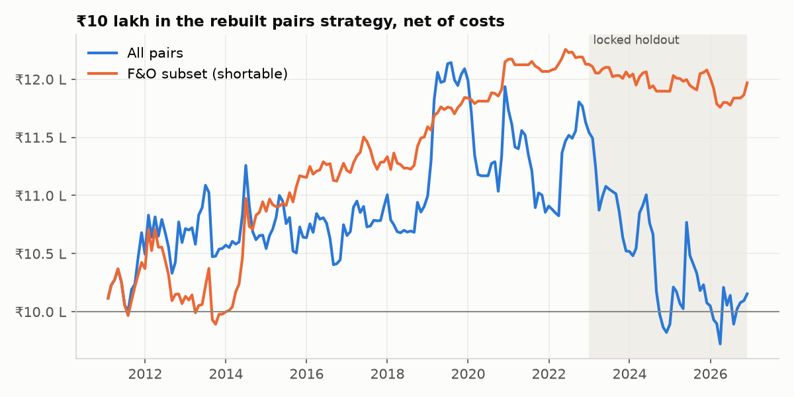

# Pairs trading on point-in-time Nifty 500: audit, rebuild and variants

Do cointegrated pairs of same-sector Indian stocks make money after costs? This project audited an earlier pairs pipeline, rebuilt it on the point-in-time Nifty 500 with a locked holdout, and then tested long-only versions. The answer is **no edge after costs.** The audit found look-ahead in pair selection and costs charged on one leg only; the original's claimed out-of-sample Sharpe above 1 was really −0.28. The rebuild's holdout, run once, gave a Sharpe of −0.54, and −0.17 for the shortable F&O subset.

*Hypothetical backtest. Costs are assumptions. Not investment advice.*

| Net of costs, ₹10 lakh | Development 2011–2022 | Holdout 2023 to Nov 2026 |
|---|---:|---:|
| Rebuild, all pairs: Sharpe (t) | 0.25 (0.86) | −0.54 (−1.05), run once |
| Rebuild, all pairs: CAGR / max drawdown | 1.2% / −12.5% | −3.3% / −16.4% |
| Rebuild, F&O subset (shortable): Sharpe | 0.48 | −0.17 |
| Rebuild: deflated Sharpe (6 trials) | 0.18 | 0.02 |
| Long-only A, pair switching: excess over 50/50 buy and hold, per month (t) | 0.12% (0.88) | −0.02% (−0.13), seen |
| Long-only B, cheap leg + Nifty futures hedge: Sharpe | 0.10 | −0.12, seen |

The rebuild's holdout was locked and run once. The long-only variants came later, so for them 2023 onward is a "seen" holdout, not out of sample. Sources: [results/summary.md](results/summary.md) and [results/long_only/summary_long_only.md](results/long_only/summary_long_only.md).



## Method

The work went in four steps. The audit of the original code (F&O stocks, Yahoo data, 2016–2026) found that pairs were chosen with correlation and cointegration tests on the full ten years and then backtested on the same ten years, and that costs were charged on one leg; with selection restricted to 2016–2022, the top three in-sample pairs had an out-of-sample Sharpe of −0.28 (t = −0.50), and all 99 selected pairs together −0.80 ([docs/audit_and_rebuild.md](docs/audit_and_rebuild.md)). The rebuild uses point-in-time Nifty 500 members from 2011 to November 2026, same-sector pairs, a 12-month formation window and 6-month trading windows, an Engle-Granger test (p < 0.05), a half-life of 5 to 60 days and the top 20 pairs; it enters at |z| > 2, exits at 0, stops at |z| > 4, and charges 10 bps plus 5/10/20 bps slippage on both legs, with point-in-time F&O eligibility from NSE bhavcopies. A leg split then showed that, against the equal-weight Nifty 500, the long leg added 0.29% a trade (t = 0.59) and the short leg 0.98% (t = 2.13), so the little signal there was sat in the short leg. The long-only variants drop exactly that leg, and none had an edge; variant A's Sharpe of 0.45 is almost all market exposure (deflated Sharpe 0.26 over 9 trials).

## Validation

All nine trials (six rebuild and three long-only) are in [results/trial_log.csv](results/trial_log.csv), each logged when it ran. The rebuild variant was chosen on development Sharpe only ([results/chosen_variant.json](results/chosen_variant.json)), and the holdout is locked by [results/holdout_lock.json](results/holdout_lock.json): the script refuses a second run. Signals use day t's close and fills day t+1's close, and deflated Sharpe ratios are computed over all trials.

## Known issues

The rebuild counts a stock as a member on its `end_date`, the day it leaves the index, so a pair can be formed or entered that day; a fix that treats membership as [start, end) was drafted but not rerun, and every reported number comes from the code as committed. Positions are equal rupees long and short in fractional shares, with no lot sizes, margin or futures basis, and 16% of trades have a hedge ratio ≤ 0 (used only for the z-score). Cash stocks cannot be shorted overnight in India, so only the F&O subset is a tradable version. The trade-level t-statistics in the leg split treat overlapping trades as independent, which overstates significance.

## Limitations

There is one holdout of 47 months, with wide error bars. Costs are assumptions, and the original audit's universe is today's F&O list, so it is survivorship-biased.

## Reproducing

The rebuild reads the momentum project's processed data, so build [momentum_research](../momentum_research) first (or set `MOMENTUM_DIR`). The original scan reads Yahoo data, which `original.py data` downloads.

```bash
pip install -e .
python scripts/rebuild.py data      # copy inputs into data/, fetch NSE F&O lists
python scripts/rebuild.py dev       # 6 trials on 2011-2022 -> results/trial_log.csv
python scripts/rebuild.py holdout   # already run once; refuses to run again
python scripts/long_only.py         # leg split and long-only variants (trials 7-9)
python scripts/original.py data && python scripts/original.py scan && python scripts/original.py audit
```

Code is in `src/pairs/`: `universe`, `selection`, `trading`, `metrics`, `rebuild` and `long_only`, with the audited original code in `src/pairs/original/`.
